# LibraryDesk: Library Inventory Management

A single-file web app (HTML, CSS, vanilla JavaScript, no dependencies) for managing a library's books, copies, loans, fines and members.

## Run
Open `index.html` in any browser. Data is held in memory (sample data is preloaded).

## Features
- **Catalog:** add books, search, multiple copies per title (duplicate ISBN adds copies), safe delete/remove
- **Circulation:** issue, return, renew once, mark lost, loan history
- **Rules:** max 3 books per member, no overdue items, fines under 100, one copy per title per member
- **Fines:** 2 per day late, 300 for lost books, pay or waive
- **Waitlist:** first-come, first-served queue; returned copies held for the next member
- **Insights:** demand score suggests which titles to buy more of; due-in-7-days chart; activity log
- **Demo control:** "Simulate +7 days" advances the clock to show overdue and fines

## Screenshots

### 1. Dashboard Overview
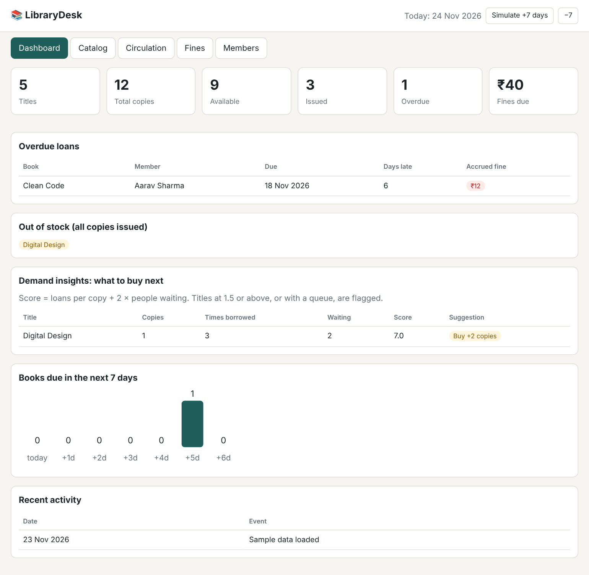

### 2. Catalog & Search
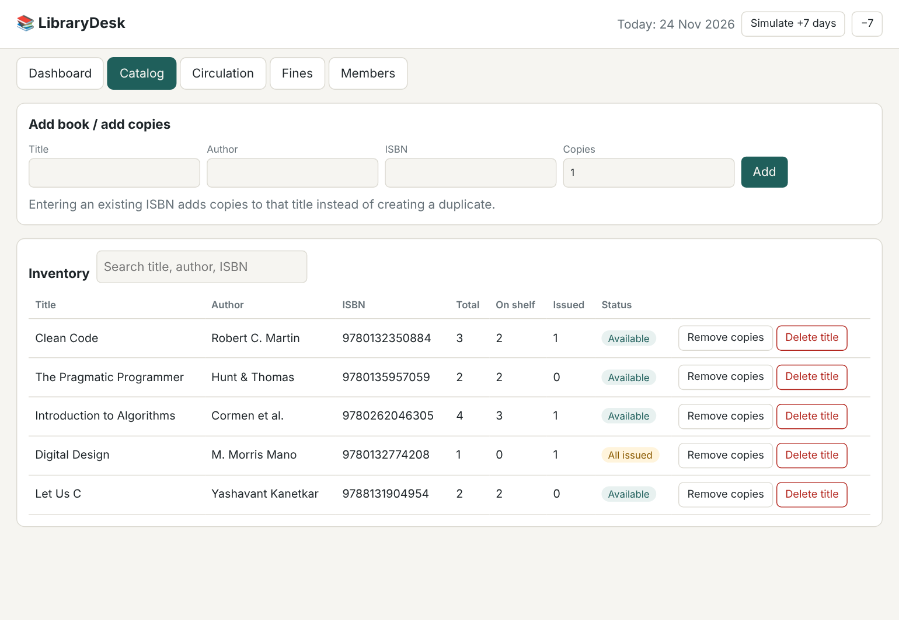

### 3. Adding Book Copies
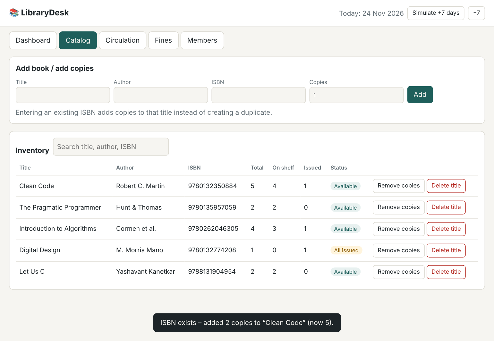

### 4. Safe Delete Protection
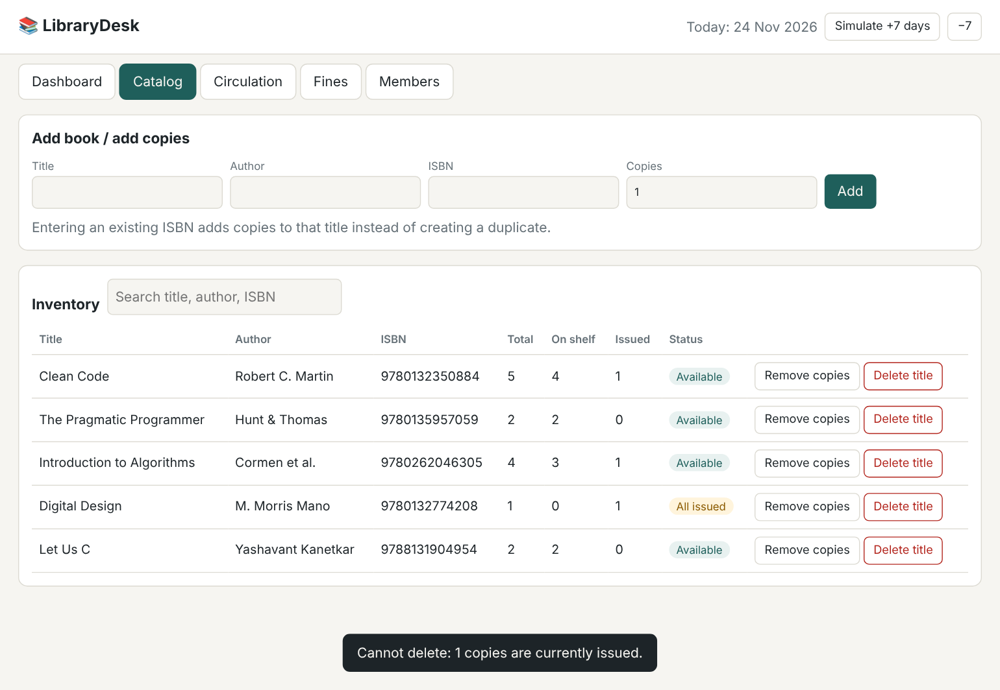

### 5. Issue Book Flow
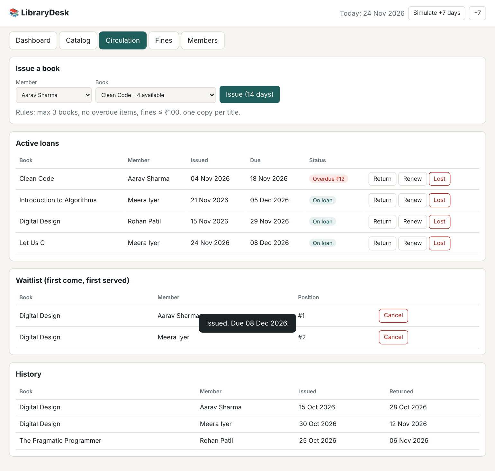

### 6. Waitlist Queue
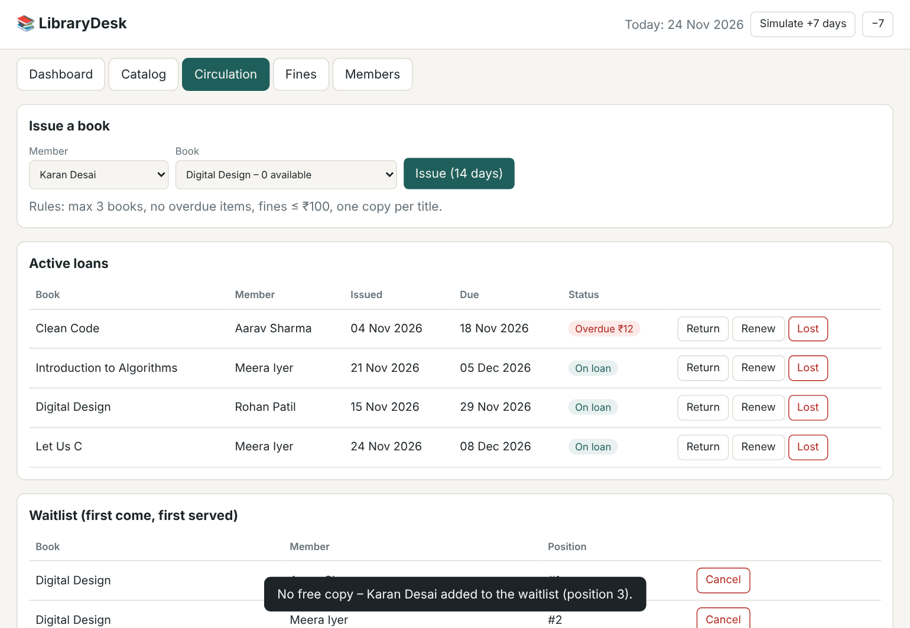

### 7. Member Borrowing Limits
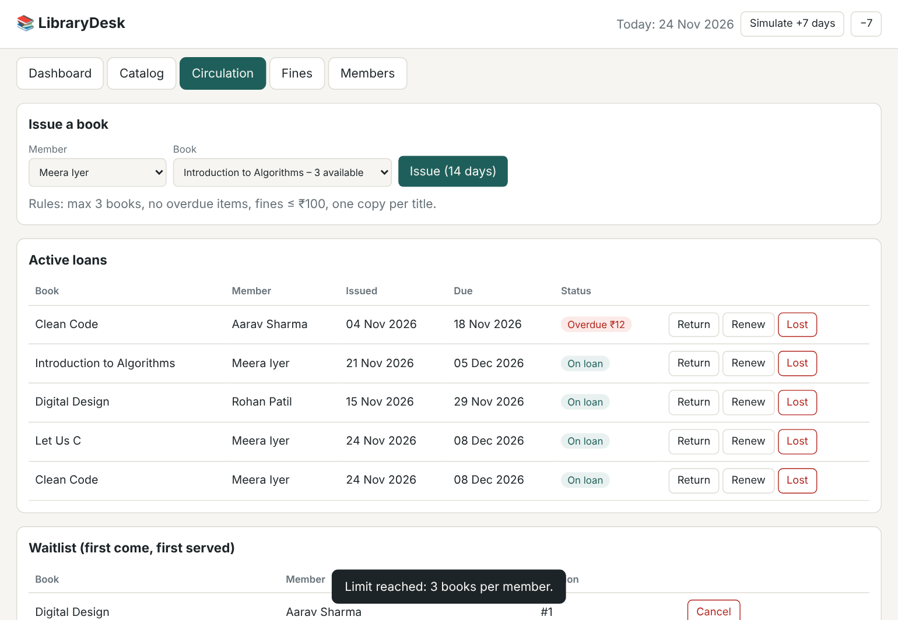

### 8. Overdue & Late Return Simulation
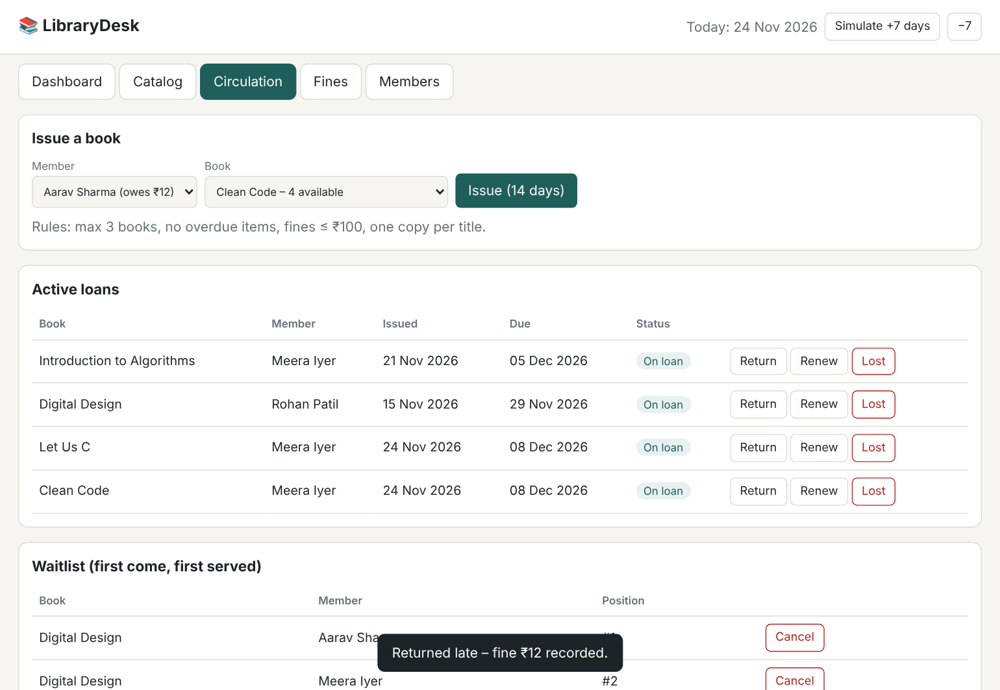

### 9. Fines Management
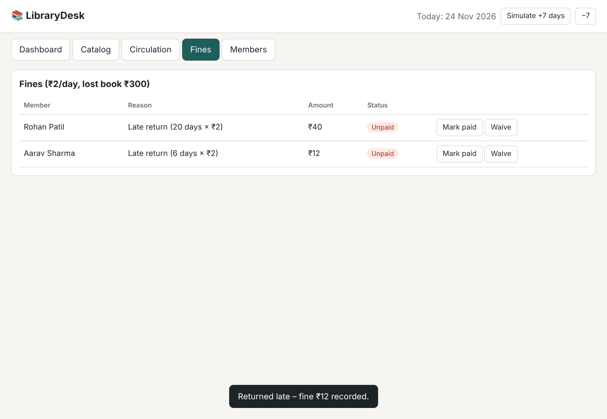

### 10. Members Directory
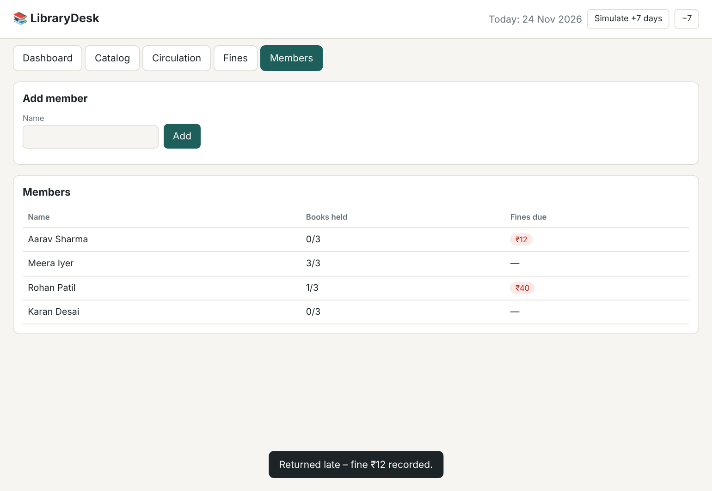

### 11. Demand Insights & Analytics
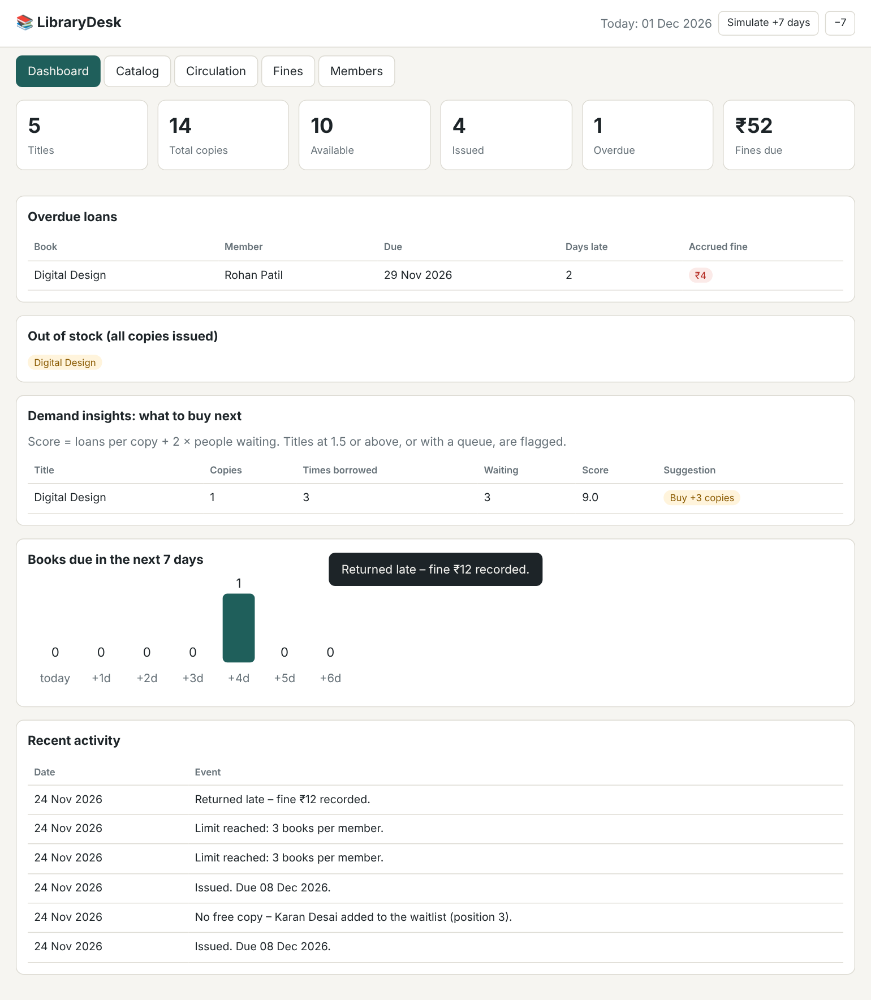

### 12. Full Circulation & Loan History
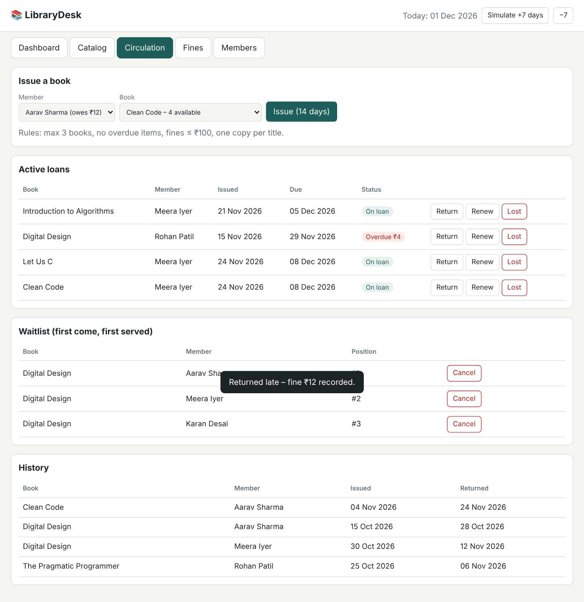

See the full write-up in `Q2_Library_Inventory_Management.pdf`.

## Future work
Date-based reservations, barcode scanning, reminders, persistent database, multiple branches, user roles.
